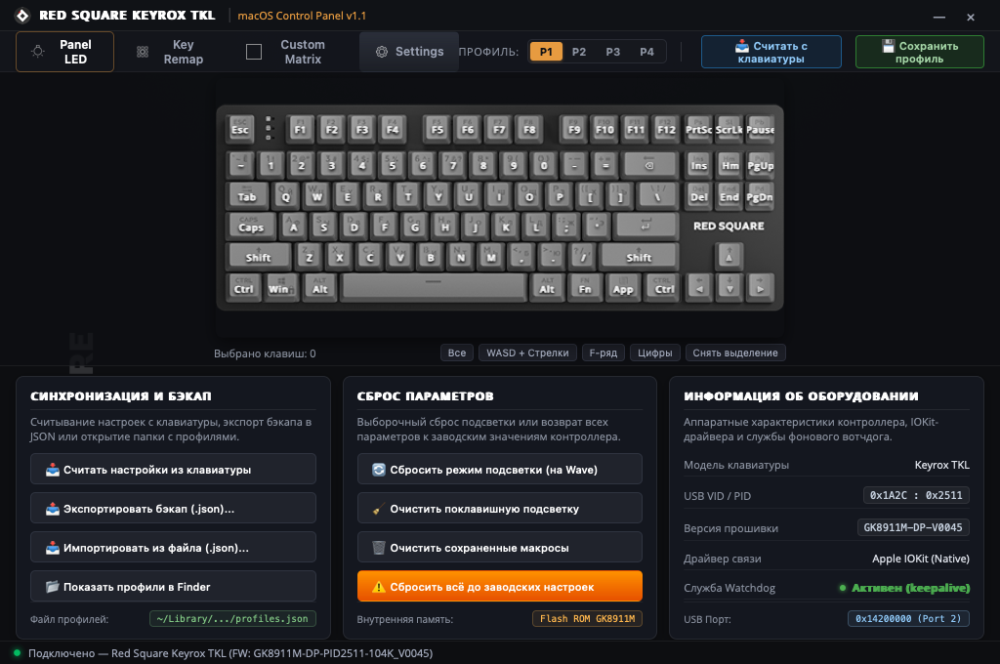

# Keyrox Control for macOS ⌨️⚡
> **Нативная панель управления и CLI-утилита для клавиатуры Red Square Keyrox TKL под macOS (Apple Silicon & Intel)**

[](https://apple.com)
[](https://github.com/sl1mus/keyrox-mac/releases/tag/v1.0.3)
[-purple)]()
[-success)]()
[-orange)]()
[](LICENSE)



---

## 🌟 О проекте / About The Project

Механическая клавиатура **Red Square Keyrox TKL** (контроллер EVision / Juchen GK8911M, USB VID `0x1A2C`, PID `0x2511`) — один из самых популярных и доступных вариантов на рынке СНГ благодаря качественным переключателям Gateron, заводской шумоизоляции и надежной конструкции.

Однако официальное программное обеспечение существует **исключительно для Windows**. Пользователи macOS оставались без возможности тонкой настройки RGB-подсветки, переназначения клавиш, создания макросов, управления профилями и страдали от зависания контроллера при переходе Mac в режим сна.

**Keyrox Control for macOS (`keyrox-mac`)** — это первая полноценная open-source реализация протокола управления, созданная методом реверс-инжиниринга оригинального USB HID протокола. Проект предоставляет как мощную CLI-утилиту, так и нативное графическое приложение с темным интерфейсом и 100% паритетом функций оригинальной Windows-утилиты.

---

## 🚀 Основные возможности

- 🔄 **Автоматическое считывание настроек (Hardware Sync):** При запуске приложение мгновенно определяет текущее состояние клавиатуры из контроллера (активный профиль, режим, яркость, скорость) — никаких дефолтных заглушек.
- 💡 **Панель подсветки (Panel LED):** 19 динамических эффектов (Статичный, Дыхание, Волна, Спектр, Рябь, Дождь, Радар, Звезды, Реактивный и др.), выбор направления волны, скорости (0..4) и яркости (0..4).
- 🎨 **Поклавишная настройка (Custom Matrix):** Интерактивная 87-клавишная визуализация с поддержкой группового выделения (Все, WASD + Стрелки, F-ряд, Цифры), палитры RGB и покадровой заливки.
- 🔀 **Переназначение клавиш (Key Remap):** Назначение любых одиночных кнопок, мультимедиа-функций (Play/Pause, громкость, треки, браузер, калькулятор), шорткатов macOS, пользовательских макросов или полное отключение клавиши.
- 💾 **Управление профилями (P1 — P4):** Мгновенное переключение профилей, запись во внутреннюю энергонезависимую Flash-память контроллера, дублирование на диск (`~/Library/Application Support/Keyrox/profiles.json`) и уведомления в виде Toast.
- ⚡ **Аппаратный перезапуск USB (Hardware Bus Reset):** Команда `keyrox-ctl revive` (и кнопка в GUI) отправляет низкоуровневый импульс сброса шины USB (SE0 bus reset) через `IOUSBHostDevice` в ядро macOS для перезагрузки зависшего микроконтроллера без физического переподключения (при активном USB-линке).
- 🪟 **Нативный macOS UX:** Компактный размер (~2.8 МБ), нулевое потребление памяти (без Electron/Node.js), поддержка свободного перетаскивания окна за шапку и плавная анимация.
- 🛡️ **Синхронизация подсветки и защита от засыпания (`keyrox-watchdog`):** Фоновый демон LaunchAgent удерживает `PreventUserIdleSystemSleep` (не препятствуя штатному сну экрана). При засыпании дисплея демон на уровне ядра (`IODisplayWrangler`) и Cocoa моментально гасит RGB-подсветку в 0, снижая ток потребления с 500 мА до ~5 мА и предотвращая Brownout-сброс контроллера GK8911M на шине xHCI. При пробуждении экрана подсветка мгновенно восстанавливается до прежнего уровня, а 10-секундный USB Heartbeat непрерывно поддерживает линк.

---

## 📦 Быстрый старт и установка

### 📥 1-Click Install (Готовый DMG)
Скачайте готовый DMG-образ последней версии:
- 🍏 **[Keyrox-macOS.dmg (v1.0.3 Universal)](https://github.com/sl1mus/keyrox-mac/releases/download/v1.0.3/Keyrox-macOS.dmg)** (1.7 MB, Apple Silicon M1/M2/M3/M4 + Intel x86_64)

### 1. Требования
- macOS 12 Monterey, macOS 13 Ventura, macOS 14 Sonoma, macOS 15 Sequoia (или новее).
- Архитектура: Apple Silicon (M1/M2/M3/M4) или Intel x86_64.
- Клавиатура: Red Square Keyrox TKL (VID: `1a2c`, PID: `2511`).

### 2. Сборка из исходников и установка графического приложения
```bash
git clone https://github.com/sl1mus/keyrox-mac.git
cd keyrox-mac

# Сборка и установка в /Applications/Keyrox.app
make -C gui install

# Запуск приложения
open /Applications/Keyrox.app
```

### 3. Сборка CLI-утилиты
```bash
make
./keyrox-ctl status
```

---

## 💻 Использование CLI-утилиты (`keyrox-ctl`)

Консольная утилита позволяет мгновенно менять параметры и автоматизировать подсветку клавиатуры в терминале, скриптах или через шорткаты macOS Shortcuts / Raycast:

```bash
# Проверить статус клавиатуры и прошивку
keyrox-ctl status

# Установить режим подсветки (wave, breath, const, ripple, rain, stars, etc.)
keyrox-ctl mode wave left
keyrox-ctl mode const

# Установить уровень яркости (0..4)
keyrox-ctl brightness 4

# Установить скорость анимации (0..4)
keyrox-ctl speed 2

# Установить цвет всей матрицы (HEX или RGB)
keyrox-ctl color "#FF0055"
keyrox-ctl color 255,128,0

# Переключить профиль (1..4)
keyrox-ctl profile 1

# Сохранить текущие параметры в Flash-память
keyrox-ctl save

# Сбросить настройки клавиатуры
keyrox-ctl reset led
keyrox-ctl reset remap
keyrox-ctl reset all

# Аппаратный сброс шины USB при зависании (Hardware Bus Reset)
keyrox-ctl revive
```

---

## ⌨️ Аппаратные комбинации клавиш (Встроенное управление Fn)

В прошивке контроллера Red Square Keyrox TKL (GK8911M / JUCHEN) аппаратно зашиты следующие сочетания клавиш (работают независимо от ОС и драйверов):

| Комбинация | Действие | Описание |
|---|---|---|
| **`Fn + ESC`** | **Мастер-питание LED** | Полное включение / выключение подсветки (аппаратный тумблер) |
| **`Fn + PRTSC`** *(Print Screen)* | **Динамические режимы** | Циклическое переключение эффектов (волна, дыхание, спектр и др.) |
| **`Fn + HOME`** | **Статичные цвета** | Переключение базовых цветов постоянного свечения (Const mode) |
| **`Fn + PAUSE`** | **Пользовательские зоны** | Переключение встроенных игровых профилей (WASD, стрелки и др.) |
| **`Fn + ↑` / `Fn + ↓`** | **Яркость подсветки** | Увеличение / уменьшение скважности аппаратного ШИМ (0..100%) |
| **`Fn + ←` / `Fn + →`** | **Скорость эффектов** | Изменение скорости динамических анимаций |
| **`Fn + DEL`** *(удержание 3–5 сек)* | **Factory Reset** | Аппаратный сброс параметров контроллера до заводских настроек |

---

## 🔬 Технические подробности протокола (Reverse Engineering)

В ходе реверс-инжиниринга оригинального исполняемого файла `KeyroxTKLSkeleton.exe` и анализа USB HID дескрипторов было установлено:
- **Устройство:** USB Composite Device, Vendor ID `0x1A2C`, Product ID `0x2511` (V2) / `0x1511` (V1).
- **Интерфейс:** Custom Vendor-Defined HID Collection (`Usage Page: 0xFF00`, `Usage: 0x0002`).
- **Транспорт:** HID Feature Reports через `IOHIDDeviceSetReport` / `IOHIDDeviceGetReport`.
- **Размер пакета:** Ровно 520 байт (Report ID отсутствует в дескрипторе HID).
- **Структура пакета на шине (Wire Layout):**
  ```c
  typedef struct __attribute__((packed)) {
      uint32_t offset;                   /* Смещение в памяти EEPROM/Flash (Little-Endian, 4 байта) */
      uint16_t len;                      /* Длина полезной нагрузки (Little-Endian, 2 байта) */
      uint8_t  cmd;                      /* Код команды (0x01: Info, 0x04: Profile, 0x06: Bright, 0x08: Mode, 0x09: Save) */
      uint8_t  subcmd;                   /* Подкоманда (1 байт) */
      uint8_t  data[KEYROX_PAYLOAD_MAX]; /* Полезная нагрузка (до 512 байт) */
  } keyrox_packet_t;
  ```
- **Особенности контроллера JUCHEN:** Попытка чтения неподдерживаемых опкодов или непредусмотренных таблиц вводит USB-стек контроллера в состояние `PIPE_STALL` (`0xe00002d6`), блокируя опрос матрицы клавиш. Все мутирующие команды (`SetMode`, `SetBrightness`, `SetSpeed`) передаются исключительно прямыми одиночными пакетами записи.

---

## 🗺️ Структура проекта

```
keyrox-ctl/
├── .github/workflows/    # CI/CD: автоматическая сборка и тесты на macOS
├── Makefile              # Сборка CLI-утилиты, демона и запуск тестов (make test)
├── keyrox_hid.c / .h     # Ядро взаимодействия с macOS IOKit HID Manager
├── keyrox_proto.c / .h   # Реализация бинарного протокола GK8911M
├── keyrox_keys.h         # Таблица скан-кодов и раскладки 87 клавиш TKL
├── keyrox_reset.m / .h   # Низкоуровневый аппаратный сброс шины USB (IOUSBHost)
├── main.c                # Точка входа консольной утилиты keyrox-ctl
├── daemon/               # Фоновый системный Watchdog (LaunchAgent 24/7)
│   ├── keyrox-watchdog.m # Демон защиты от зависаний при выходе из сна
│   └── io.github.sl1mus.keyrox-watchdog.plist
├── tests/                # Модульные тесты протокола HID (make test)
│   └── test_proto.c
├── gui/
│   ├── Makefile          # Сборка Keyrox.app (Mach-O + WebKit bundle)
│   ├── Info.plist        # Метаданные бандла приложения
│   ├── src/
│   │   ├── AppDelegate.m # Мост AppKit, IOKit poller, drag view, snapshot
│   │   └── main.m        # NSApplication runtime
│   └── ui/
│       ├── index.html    # Разметка интерфейса (Panel LED, Remap, Matrix, Settings)
│       ├── style.css     # Темная геймерская CSS-тема
│       ├── app.js        # Двусторонний реактивный движок UI и синхронизации
│       └── keys.js       # Данные геометрии клавиатуры TKL
```

---

## 👥 Авторы и контрибьюторы (Contributors)

* **[@sl1mus](https://github.com/sl1mus)** — Автор проекта, реверс-инжиниринг протокола GK8911M, архитектура нативного macOS интерфейса и драйвера.
* **[Antigravity Agent](https://github.com/apps/antigravity-sl1mus) ([@antigravity-sl1mus[bot]](https://github.com/apps/antigravity-sl1mus))** — AI-ассистент разработки: модульный тестовый сьют протокола (`tests/test_proto.c`), устранение багов RunLoop/GCD в Watchdog Daemon, автоматизация CI (GitHub Actions) и ревью кода.

---

## 🤝 Вклад в проект (Contributing)
Пулл-реквесты, issue и предложения приветствуются! Если у вас другая модель Red Square (Keyrox Classic, Keyrox 60%, Redeemer) или другая версия прошивки — присылайте дампы и фидбек! Подробнее в [CONTRIBUTING.md](CONTRIBUTING.md).

---

## 📄 Лицензия
Проект распространяется под лицензией **MIT**. Подробности в файле [LICENSE](LICENSE).

*Дисклеймер: Данный проект является независимой разработкой с открытым исходным кодом и не аффилирован с торговой маркой Red Square или компанией Dark Project.*
