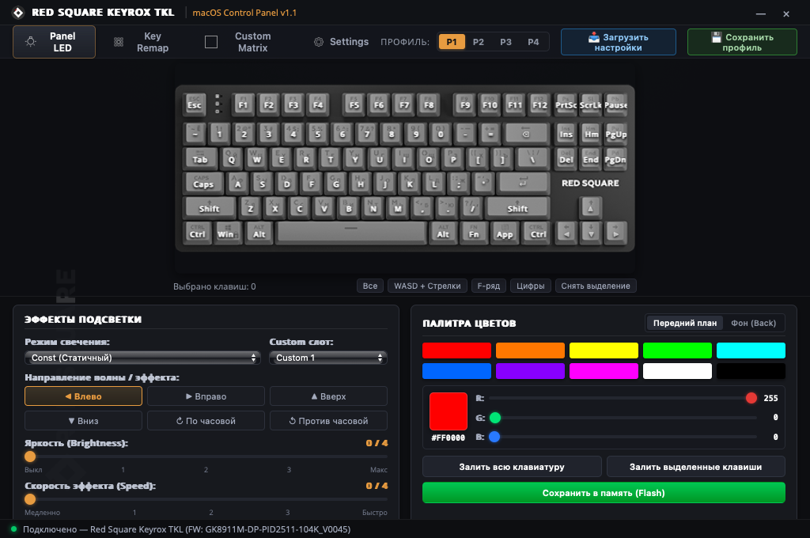

# Keyrox Control for macOS ⌨️⚡
> **Нативная панель управления и CLI-утилита для клавиатуры Red Square Keyrox TKL под macOS (Apple Silicon & Intel)**

[](https://apple.com)
[-purple)]()
[]()
[-orange)]()
[](LICENSE)



---

## 🌟 О проекте / About The Project

Механическая клавиатура **Red Square Keyrox TKL** (контроллер EVision / Juchen GK8911M, USB VID `0x1A2C`, PID `0x2511`) — один из самых популярных и доступных вариантов на рынке СНГ благодаря качественным переключателям Gateron, заводской шумоизоляции и надежной конструкции.

Однако официальное программное обеспечение существует **исключительно для Windows**. Пользователи macOS оставались без возможности тонкой настройки RGB-подсветки, переназначения клавиш, создания макросов, управления профилями и страдали от сброса настроек при переходе Mac в режим сна.

**Keyrox Control for macOS** — это первая полноценная open-source реализация протокола управления, созданная методом реверс-инжиниринга оригинального USB HID протокола. Проект предоставляет как мощную CLI-утилиту, так и нативное графическое приложение с темным геймерским интерфейсом и 100% паритетом функций оригинальной Windows-утилиты.

---

## 🚀 Основные возможности

- 🔄 **Автоматическое считывание настроек (Hardware Sync):** При запуске приложение мгновенно определяет текущее состояние клавиатуры из контроллера (активный профиль, режим, яркость, скорость) — никаких дефолтных заглушек.
- 💡 **Панель подсветки (Panel LED):** 19 динамических эффектов (Статичный, Дыхание, Волна, Спектр, Рябь, Дождь, Радар, Звезды, Реактивный и др.), выбор направления волны, скорости (0..4) и яркости (0..4).
- 🎨 **Поклавишная настройка (Custom Matrix):** Интерактивная 87-клавишная визуализация с поддержкой группового выделения (Все, WASD + Стрелки, F-ряд, Цифры), палитры RGB и покадровой заливки.
- 🔀 **Переназначение клавиш (Key Remap):** Назначение любых одиночных кнопок, мультимедиа-функций (Play/Pause, громкость, треки, браузер, калькулятор), шорткатов macOS, пользовательских макросов или полное отключение клавиши.
- 💾 **Управление профилями (P1 — P4):** Мгновенное переключение профилей, запись во внутреннюю энергонезависимую Flash-память контроллера, дублирование на диск (`~/Library/Application Support/Keyrox/profiles.json`) и уведомления в виде Toast.
- 🪟 **Нативный macOS UX:** Компактный размер (~2.9 МБ), нулевое потребление памяти (без Electron/Node.js), поддержка свободного перетаскивания окна за шапку и плавная анимация.
- 🛡️ **Защита от засыпания:** Автоматический LaunchAgent watchdog (`juchen-keepalive`), предотвращающий отвал или зависание USB HID интерфейса при сне macOS.

---

## 📦 Быстрый старт и установка

### 1. Требования
- macOS 12 Monterey, macOS 13 Ventura, macOS 14 Sonoma, macOS 15 Sequoia (или новее).
- Архитектура: Apple Silicon (M1/M2/M3/M4) или Intel x86_64.
- Клавиатура: Red Square Keyrox TKL (VID: `1a2c`, PID: `2511`).

### 2. Сборка и установка графического приложения
```bash
git clone https://github.com/<your-username>/keyrox-mac.git
cd keyrox-mac

# Сборка и установка в /Applications/Keyrox.app
make -C gui install

# Запуск приложения
open /Applications/Keyrox.app
```

### 3. Сборка CLI-утилиты
```bash
make
./keyrox-ctl status
```

---

## 💻 Использование CLI-утилиты (`keyrox-ctl`)

Консольная утилита позволяет мгновенно менять параметры и автоматизировать подсветку клавиатуры в терминале, скриптах или через шорткаты macOS Shortcuts / Raycast:

```bash
# Проверить статус клавиатуры и прошивку
keyrox-ctl status

# Установить режим подсветки (wave, breath, const, ripple, rain, stars, etc.)
keyrox-ctl mode wave left
keyrox-ctl mode const

# Установить уровень яркости (0..4)
keyrox-ctl brightness 4

# Установить скорость анимации (0..4)
keyrox-ctl speed 2

# Установить цвет всей матрицы (HEX или RGB)
keyrox-ctl color "#FF0055"
keyrox-ctl color 255,128,0

# Переключить профиль (1..4)
keyrox-ctl profile 1

# Сохранить текущие параметры в Flash-память
keyrox-ctl save

# Сбросить настройки клавиатуры
keyrox-ctl reset led
keyrox-ctl reset remap
keyrox-ctl reset all
```

---

## 🔬 Технические подробности протокола (Reverse Engineering)

В ходе реверс-инжиниринга оригинальной Windows-утилиты (`Skin.dll`, `res.dll`) и сниффинга USB-пакетов было установлено:
- **Устройство:** USB Composite Device, Vendor ID `0x1A2C`, Product ID `0x2511`.
- **Интерфейс:** Custom Vendor-Defined HID Collection (`Usage Page: 0xFF00`, `Usage: 0x0001`).
- **Транспорт:** HID Feature Reports через `IOHIDDeviceSetReport` / `IOHIDDeviceGetReport`.
- **Размер пакета:** 65 байт (1 байт Report ID `0x04` + 64 байта полезной нагрузки).
- **Структура пакета:**
  ```c
  typedef struct __attribute__((packed)) {
      uint8_t  magic;       /* 0xA5 */
      uint8_t  cmd;         /* Command ID (0x02: Info, 0x03: Mode, 0x04: Remap, 0x07: LED, 0x09: Save) */
      uint8_t  subcmd;      /* Subcommand */
      uint8_t  len;         /* Payload byte length */
      uint32_t offset;      /* Memory/Key offset (Big-Endian) */
      uint8_t  data[52];    /* Payload data */
      uint8_t  checksum;    /* 8-bit sum over bytes [0..62] */
  } keyrox_packet_t;
  ```

---

## 🗺️ Структура проекта

```
keyrox-ctl/
├── Makefile              # Сборка CLI-утилиты keyrox-ctl
├── keyrox_hid.c / .h     # Ядро взаимодействия с macOS IOKit HID Manager
├── keyrox_proto.c / .h   # Реализация бинарного протокола GK8911M
├── keyrox_keys.h         # Таблица скан-кодов и раскладки 87 клавиш TKL
├── main.c                # Точка входа консольной утилиты
├── gui/
│   ├── Makefile          # Сборка Keyrox.app (Mach-O + WebKit bundle)
│   ├── Info.plist        # Метаданные бандла приложения
│   ├── src/
│   │   ├── AppDelegate.m # Мост AppKit, IOKit poller, drag view, snapshot
│   │   └── main.m        # NSApplication runtime
│   └── ui/
│       ├── index.html    # Разметка интерфейса (Panel LED, Remap, Matrix, Settings)
│       ├── style.css     # Темная геймерская CSS-тема
│       ├── app.js        # Двусторонний реактивный движок UI и синхронизации
│       └── keys.js       # Данные геометрии клавиатуры TKL
```

---

## 🤝 Вклад в проект (Contributing)
Пулл-реквесты, issue и предложения приветствуются! Если у вас другая модель Red Square (Keyrox Classic, Keyrox 60%, Redeemer) или другая версия прошивки — присылайте дампы и фидбек!

---

## 📄 Лицензия
Проект распространяется под лицензией **MIT**. Подробности в файле [LICENSE](LICENSE).

*Дисклеймер: Данный проект является независимой разработкой с открытым исходным кодом и не аффилирован с торговой маркой Red Square или компанией Dark Project.*
